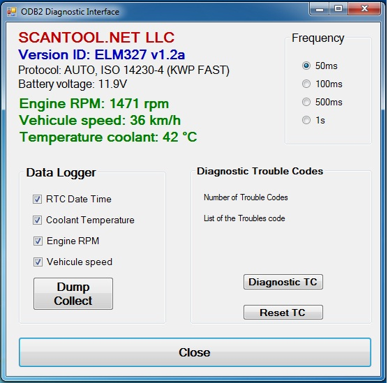
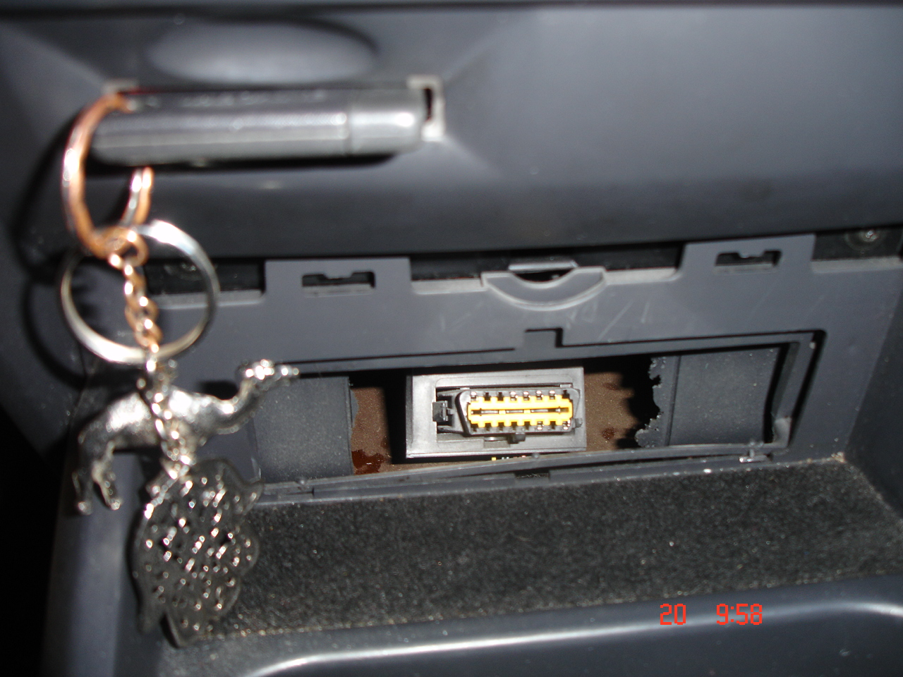
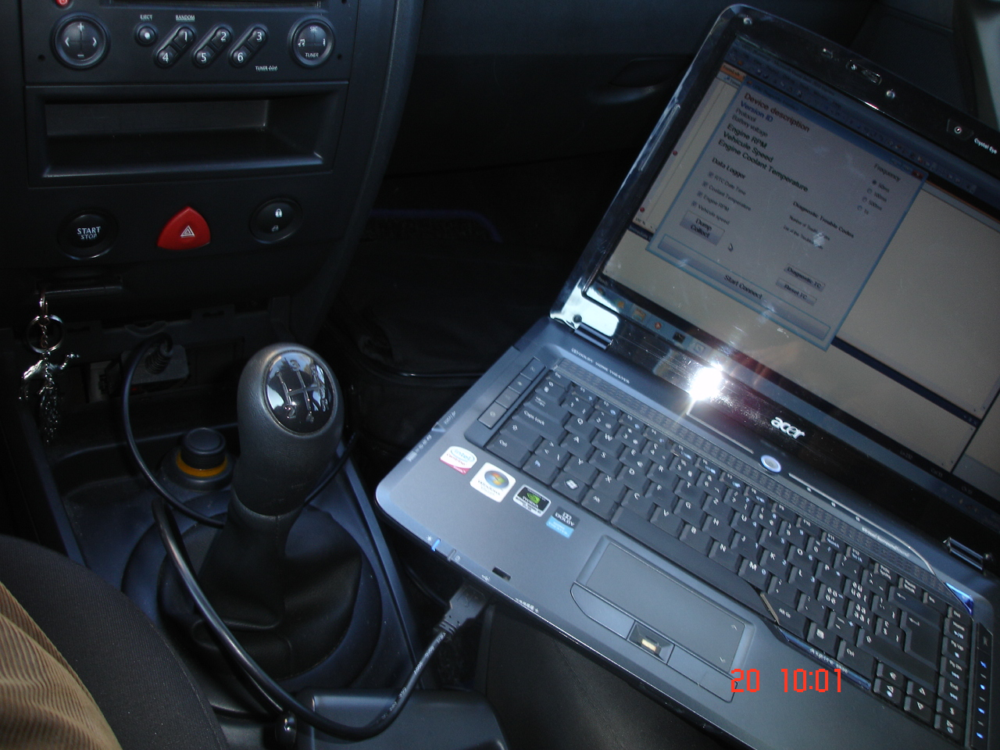

# OBD-II Diagnostic Interface — PC GUI (VB.NET)

A Windows desktop application that talks to a car's **On-Board Diagnostics (OBD-II)** port through an **ELM327** scan tool over a serial connection. It reads live sensor data, logs it to a file and reads or clears diagnostic trouble codes.

<p align="center">
  
</p>

## Background

Almost every car produced today is required by law to provide an interface for diagnostic test equipment. The data on these interfaces follows several standards, none of which is directly usable by a PC. With an ELM327-based scan tool as the bridge, this program sends OBD-II requests and AT commands and decodes the responses into readable values.

## Features

- **Live data**: engine RPM, vehicle speed and coolant temperature
- **Adapter info**: device description, ELM327 version, detected protocol and battery voltage
- **Adjustable polling rate**: 50 ms, 100 ms, 500 ms or 1 s
- **Data logger**: records timestamped measurements and dumps them to a text file (CSV format)
- **Trouble codes (DTC)**: read stored codes (Mode 03) and reset them (Mode 04)

## Supported Requests

| Command | Description | Decoding |
|---------|-------------|----------|
| `0105` | Engine coolant temperature | `A − 40` °C |
| `010C` | Engine RPM | `(256·A + B) / 4` rpm |
| `010D` | Vehicle speed | `A` km/h |
| `03` / `04` | Read / clear trouble codes | — |
| `ATI`, `AT@1` | Adapter version / description | — |
| `ATDP` | Current protocol | — |
| `ATRV` | Battery voltage | — |

## In the Car

Tested on a **Renault Mégane II** (protocol ISO 14230-4 KWP2000 Fast).

| OBD-II port | Laptop connected |
|:-:|:-:|
|  |  |

## Repository Structure

```
.
├── src/ODB2/            # Visual Studio solution (VB.NET, WinForms, .NET Framework 4.0)
│   ├── ODB2.sln
│   └── ODB2/            # Form1.vb (logic), Form1.Designer.vb (UI), project files
├── docs/                # ELM327 datasheet, OBD-II PID reference
├── logs/                # Data-logger output (txt / xlsx) from test drives
│   └── elm327_sessions/ # Raw terminal sessions: protocols, PID scan, DTC reset
└── photos/              # GUI screenshots and in-car setup
```

## Getting Started

1. Open `src/ODB2/ODB2.sln` in Visual Studio.
2. Plug the ELM327 adapter into the car's OBD-II port and connect it to the PC.
3. Set the serial port in `Form1.vb` (default **COM3**, **38400 baud**).
4. Build and run, then click **Start / Connect** with the ignition on.

## Sample Log

```
Date Time,  Coolant Temperature, Vehicule speed, Engine RPM
20.03.2011 18:37:44,23,0,1581
20.03.2011 18:37:46,23,0,1577
20.03.2011 18:37:48,23,0,1597
```

## Tech Stack

VB.NET · Windows Forms · .NET Framework 4.0 · System.IO.Ports (serial) · ELM327 · OBD-II (SAE J1979)

## Author

**Akram M'Tir**, [@amtir](https://github.com/amtir)
